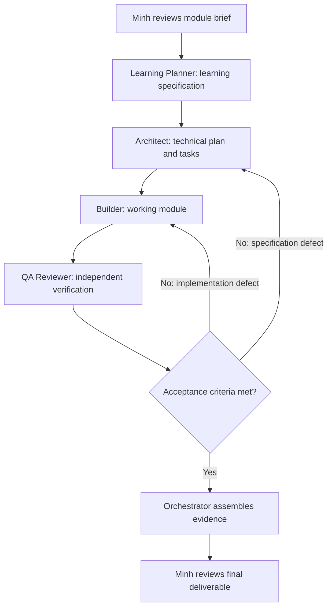

# STEM Module Multi-Agent Platform: Design Proposal

Date: October 30, 2026  
Status: draft for Minh's review; updated with exemplar-learning clarification  
Scope of this document: system design; implementation status is tracked in the README

## 1. Problem and intended outcome

Building an interactive learning module requires scientific implementation, instructional content, visualization, web integration, and verification. Repeating these decisions for each module creates avoidable work and inconsistent results.

The proposed platform is initially a repository-based development workflow: specialized agents use reusable skills and an existing-module corpus to turn a module brief into a working, reviewable learning module built with Python, Bokeh, Flask, and HTML.

Minh's clarification: SINDy and other modules are learning examples for UI design, inputs/outputs, layout, data handling, implementation, and presentation. Agents should inspect and adapt these patterns, use their model's reasoning and current technical sources to fill gaps, and improve results based on review. A neural-network equation-discovery request must drive method/package selection, data processing, controls, diagnostics, output representation, and measured execution budgets. The initial implementation supplies examples in context; it does not train model weights. Literal fine-tuning would be a separate implementation decision.

The intended outcome is lower human development effort while maintaining explicit scientific, instructional, and software quality requirements. Speed improvements must be measured rather than assumed from the number of agents.

### Users

- Primary users: Minh and other developers building STEM/data science modules.
- Reviewers: faculty and technical advisors reviewing learning goals, scientific correctness, and implementation quality.
- End users of generated modules: learners. Their education level and prerequisites must be specified per module; these have not yet been agreed for the project.

### Example input and output

Input: “Build a linear regression lesson for introductory undergraduate learners who know basic algebra. Let learners explore noise, fitted lines, residuals, and held-out error using synthetic data.”

Output: an isolated module directory containing working source code, instructional HTML, reproducible example data or a seeded generator, dependency configuration, meaningful tests, launch instructions, and a QA report linked to its acceptance criteria.

This example is a proposed pilot brief, not a confirmed curriculum requirement.

## 2. Evidence and starting point

Raghu's email requests independent agents with appropriate skills grounded in STEM learning, Python, Flask, and Bokeh. Minh is asked to prepare the setup and share an outline; Srinivas is asked to contribute open-source reference material. Python 3.14 is a planned environment upgrade, not a verified compatibility baseline.

The existing SINDy application provides useful reference patterns:

- `engine/` separates scientific computation from UI construction.
- `tabs/` contains Bokeh layouts and interaction callbacks.
- `main.py` builds the Bokeh application and creates session-specific state.
- `flask_app.py` serves HTML and embeds the Bokeh server application.
- `templates/` and `static/` provide learning content and presentation assets.
- `tests/` includes scientific, UI-contract, and application smoke checks.
- `run.sh` and `render.yaml` illustrate local and hosted two-service operation.

These are observations from source inspection, not a new validation of the running application. The current requirements list does not pin versions. The pilot needs its own reproducible environment before compatibility claims are made.

SINDy is the initial source-backed learning exemplar, not a requirement to reuse its equations, four-tab layout, or all of its dependencies. Extract patterns that fit the new module. Maintain a catalog of modules, case studies, source revisions/hashes, review status, and feedback. An adaptation table must connect each selected pattern to the new requirements and explain improvements. Additional modules can extend the corpus without changing this contract.

## 3. MVP scope and boundaries

### Included

- A documented module brief and shared module contract.
- Shared role/skill sources with a verified Codex execution path and a Claude adapter, whose live support is verified separately.
- An orchestrator that executes the agreed workflow and records handoffs.
- Four specialized agent roles: Learning Planner, Architect, Builder, and QA Reviewer.
- A focused skill library with references, examples, and validation scripts where useful.
- A source-backed module corpus with explicit adaptation records and review feedback.
- A reusable Flask/Bokeh/HTML module scaffold.
- One end-to-end pilot and a second module for evaluating reuse.
- Traceable run artifacts, setup instructions, and an evaluation report.

### Deferred

- A separate web dashboard for managing agents, authentication, or multi-user job hosting.
- A custom orchestration framework before an existing runtime has been evaluated.
- Fine-tuning, a vector database, or a RAG service. The initial design uses task-time access to curated files and documentation.
- Fully autonomous deployment or publication of generated modules.
- Additional runtimes beyond Codex and Claude Code in the first release.

The generated learning applications use Flask and Bokeh; the agent orchestration process does not have to be a Flask application.

## 4. Agent architecture and responsibilities

A single orchestrator coordinates the workflow. “Independent” means separate task context, responsibilities, and outputs; it does not imply that dependent stages run simultaneously.

| Role | Responsibility | Required output | Proposed write scope |
| --- | --- | --- | --- |
| Orchestrator | Validate inputs, dispatch work, track state, enforce stage gates, assemble results | Run manifest, task assignments, handoff records, final summary | Run metadata and handoffs |
| Learning Planner | Define learning objectives, prerequisites, lesson sequence, misconceptions, and assessment | Learning specification and measurable acceptance criteria | Run specifications |
| Architect | Design computation, data flow, UI interactions, module interfaces, and verification approach | Technical plan and task breakdown | Run architecture documents |
| Builder | Implement the approved specification and resolve reported defects | Module code, learning content, dependencies, tests, and launch instructions | Assigned module directory |
| QA Reviewer | Independently check scientific behavior, interactions, instructional coverage, and reproducibility | Criterion-by-criterion QA report with evidence and defects | Run QA reports and independent verification tests |

Minh reviews the initial brief and the final result. Faculty or a subject expert may need to review scientific and instructional content; passing automated tests does not establish learning effectiveness.

The QA Reviewer reports application defects to the Builder rather than silently changing application code. The Architect proposes specification changes when a defect exposes a design problem. Only one Builder edits a given module at a time in the MVP.

Directory scopes in prompts are workflow guidance. They must not be described as enforced permissions unless the selected runtime actually restricts writes. Runtime selection must include checking what enforcement is available.

## 5. Workflow, handoffs, and failure handling



### Stage gates

1. **Brief ready:** audience, topic, prerequisites, objectives, interaction requirements, scientific assumptions, data needs, and constraints are explicit. Missing optional details can use recorded assumptions; missing information that changes correctness or scope must be resolved before dependent work.
2. **Design ready:** learning and technical specifications agree; each acceptance criterion has an ID, a verification method, and a responsible role.
3. **Build ready for QA:** the module starts using documented commands; code, content, dependency configuration, and initial verification results are present.
4. **QA passed:** all mandatory criteria pass with evidence. Skipped or blocked checks remain visible and prevent a complete status when they are required.
5. **Ready for review:** the final package includes known limitations and all information needed for Minh to assess the result.

### Handoff contract

Each handoff records:

- Run ID, task ID, producing role, and receiving role.
- Input paths and versions or revisions used.
- Output paths and acceptance criteria addressed.
- Decisions, assumptions, and unresolved questions.
- Verification commands, results, and relevant evidence paths.
- Status: ready, needs revision, or blocked.

Agent chat history is not the sole record of a decision. Persistent artifacts must contain the information needed by the next stage.

### Bounded iteration

Start with a configurable limit of two Builder/QA repair cycles after the initial build. If mandatory criteria still fail, stop with a needs-review status and unresolved defects. Runtime failures and unavailable dependencies must be reported explicitly. The orchestrator must not label an incomplete run successful or invent passing test results.

Record stage state so a run can be resumed from the last accepted artifact after the cause of a failure is addressed. Set a run budget before execution; the mechanism and units depend on the selected runtime.

## 6. Skill library

Skills capture project-specific methods and examples, rather than repeating general programming knowledge.

| Proposed skill | Contents | Main consumers |
| --- | --- | --- |
| Existing-module examples | Source-backed UI/input/data/implementation patterns, provenance, limitations, and adaptation records | Planner, Architect, Builder, QA |
| STEM lesson design | Objectives, explanations, misconceptions, assessment with answers, accessibility guidance | Planner, QA |
| Scientific Python | Scientific assumptions, units, reference calculations, input validation, reproducibility, numerical edge cases | Architect, Builder, QA |
| Bokeh interaction | Data sources, widgets, callbacks, session isolation, labels, and interaction checks | Architect, Builder, QA |
| Flask–Bokeh integration | Routes, templates, server embedding, WebSocket configuration, startup and shutdown | Architect, Builder, QA |
| Learning module UI | Lesson layout, control instructions, feedback, readable plots, HTML/CSS conventions | Planner, Builder, QA |
| Module verification | Acceptance mapping, independent numerical checks, application checks, browser verification, QA reporting | Architect, QA |

Each skill should have a concise `SKILL.md` with a clear activation description, procedure, expected outputs, and directly linked supporting files. Add `references/`, `examples/`, and `scripts/` only when they serve a concrete need.

Maintain a source manifest with URL, title or source ID, version or access date, topic, license information where applicable, and any local derivative. The initial manifest is `sources.json`; local module records live in `corpus/catalog.json`. Srinivas's materials can extend this collection. Initial candidates are official Python, Flask, and Bokeh documentation plus suitable openly licensed scientific examples.

Test skill selection and use with at least three representative cases across the initial library: a new module, a modification to an existing module, and a scientific or interaction defect. Verify actual skill availability in agent contexts rather than assuming inheritance from the orchestrator.

## 7. Shared module contract and proposed structure

Every module must define its scientific assumptions, inputs and valid ranges, outputs and units, expected interactions, short ordered usage instructions, learning objectives, assessment, and verification requirements. The shared page shell presents the title, usage guide, Back to home navigation, and then a full-width interactive workspace. Objectives, assumptions, questions, and answers remain module metadata for planning and QA without occupying persistent side rails or quiz sections. Avoid shared mutable scientific state between learner sessions.

The scaffold should separate computation, Bokeh UI, Flask/HTML, and tests. It must document the browser's connection to the Bokeh service as well as the Flask entry point. A Flask HTTP success response alone does not verify a working embedded Bokeh interaction.

Proposed project structure after later implementation:

```text
multi-agent-platform/
  README.md
  docs/
    design-proposal.md
    runtime-decision.md
    usage.md
  AGENTS.md               # Shared project guidance
  agents/                 # Canonical role specifications
  .agents/skills/         # Canonical skills and orchestration entry point
  .codex/agents/          # Generated Codex role adapters
  .claude/agents/         # Generated Claude role adapters
  .claude/skills/         # Generated Claude skill copies
  corpus/                 # Module catalog and source-backed case studies
  briefs/                 # Concrete pilot briefs
  templates/              # Brief, handoff, QA report, module scaffold
  sources.json
  scripts/                # Local setup/reference checks
  evaluations/            # Behavioral evaluation cases
  modules/                # Generated modules, each with its own dependencies
  runs/                   # Specs, handoffs, evidence, QA, evaluation records
```

Shared configuration uses `AGENTS.md`, canonical `agents/` and `.agents/skills/`, and generated Codex/Claude adapters; see `runtime-decision.md` for rationale and limitations. Module scaffolds, generated modules, and run evidence are later work. Configuration presence does not establish runtime discovery or successful execution. Keep corpus and artifact formats portable if another runtime is selected.

## 8. Pilots and verification

### Pilot A: projectile motion

Purpose: exercise the complete workflow using a model with straightforward analytical checks. This pilot was suggested in the supplied context.

Proposed behavior: learners vary initial speed and launch angle; Bokeh updates the trajectory and derived quantities. State the simplifying assumptions, including constant gravity, no drag, and equal launch/landing height if that formula is used. Include units, objectives, and at least three questions with answers or feedback.

Verify calculations against analytical expectations, valid-range boundaries, callback updates, the embedded browser experience, and isolation between two sessions. Include a zero-speed case if supported, or an explicit validation message if excluded by the brief.

### Pilot B: linear regression

Purpose: assess transfer to the project's data science use case without rewriting the workflow.

Proposed behavior: learners explore a seeded synthetic dataset, noise, fitted lines, residuals, and train/test error. Fit only on training data; make split behavior and random seeds explicit. Include meaningful scientific and instructional checks.

The module should use the same roles, handoff format, and scaffold as Pilot A. Record any changes to skills or infrastructure needed for the second module; do not hide bespoke rework when assessing reuse.

## 9. Definition of success

### Functional MVP acceptance

| ID | Required outcome | Evidence |
| --- | --- | --- |
| MVP-01 | Actual agents execute their assigned stages and access the intended skills | Runtime execution records, skill-loading evidence supported by the runtime, and handoff artifacts |
| MVP-02 | Another developer can set up and run the workflow from the README | Recorded clean setup with prerequisites and commands |
| MVP-03 | Pilot A launches reproducibly and passes every mandatory module criterion | Locked dependency environment, launch instructions, test results, browser evidence, and QA report |
| MVP-04 | Computation and interactions are correct for normal and specified edge cases | Independent reference checks and interaction verification |
| MVP-05 | Instructional content matches the stated audience and objectives | Review of assumptions, units, explanations, and at least three assessment questions with answers |
| MVP-06 | Defects and failed checks remain traceable through repair | QA findings, linked changes, and re-verification evidence; use a controlled faulty fixture if no natural defect occurs |
| MVP-07 | Output is ready for human review | Source, setup instructions, criterion-to-evidence mapping, and limitations |

### Reuse and efficiency evaluation

- Complete Pilot B with the same workflow and record all infrastructure changes required.
- Compare equivalent tasks with and without the multi-agent workflow, holding module requirements and acceptance criteria constant. The baseline should represent the team's current development workflow, including any AI assistance normally used.
- Record elapsed time, active human effort, clarification/correction rounds, final quality, runtime/model versions, and model usage or cost where available.
- Initial target: at least 30% lower median active human effort across at least three matched task pairs, while both approaches meet the same mandatory quality criteria. Report individual results, unsuccessful runs, and setup/maintenance effort separately.
- Treat this as a small exploratory evaluation. One successful demo establishes feasibility, not a general productivity gain. If reliable usage or cost data is unavailable, report it as unavailable.

Functional MVP completion and proof of efficiency are separate milestones. A working workflow may still need improvement if the efficiency target is not met.

### Python environment acceptance

Establish one reproducible supported Python/dependency environment first. When the requested Python 3.14 environment becomes available, rerun installation, numerical tests, app startup, and browser interaction checks there. Document verified support or specific blockers; do not infer compatibility from the interpreter version alone.

## 10. Delivery sequence and review gates

| Step | Deliverable | Completion gate |
| --- | --- | --- |
| 1 | This design proposal | Minh reviews scope, workflow, and success criteria |
| 2 | Runtime decision and module brief | Supported runtime, audience, pilot assumptions, and resource budget are agreed |
| 3 | Agent and skill setup | A small task demonstrates real dispatch, skill access, and recorded handoffs |
| 4 | Module scaffold and Pilot A | All functional MVP criteria pass |
| 5 | Pilot B and evaluation | Reuse and efficiency findings are documented honestly |
| 6 | Handoff package | Another developer can follow the usage guide and produce a reviewable result |

The Monday outline can present the design, planned roles and skills, pilot brief, acceptance criteria, and decisions needing advisor input. Working agent/skill skeletons are a later deliverable and should only be described as available after they are implemented and checked. No delivery-time estimate is committed by this design.

## 11. Decisions still open

| Decision | Proposed starting point | Why it matters |
| --- | --- | --- |
| Agent runtime | Use the current Codex session now and retain a Claude adapter; record native explicit-file assignment separately from automatic project discovery | Determines executable configuration, tools, permissions, skills, and evidence collection |
| Pilot audience | Introductory undergraduate learners, pending faculty input | Determines terminology, prerequisites, explanations, and assessment |
| Pilot selection | Projectile motion for workflow validation, then linear regression for data science reuse | Separates orchestration feasibility from domain transfer |
| Reference materials | Official technical docs plus Srinivas's curated scientific/teaching sources | Determines provenance and content coverage |
| Environment | Reproducible verified environment first; assess Python 3.14 when available | Prevents unsupported compatibility claims |
| Resource limits | Agree time/model-usage limits before pilot runs | Bounds iteration and enables meaningful cost evaluation |
| Future repository location | Keep this directory isolated now; decide whether to move it to a dedicated repo before runtime setup | Affects configuration discovery, dependencies, and project ownership |

These are proposals, not decisions already approved by Raghu. Minh authorized continuing with initial setup for review; live runtime validation and generated modules remain separate milestones.

## 12. References

- Raghu's email supplied by Minh: project intent, responsibilities, and planned environment upgrade.
- User-supplied context brief: preliminary roles, skills, projectile-motion pilot, and unresolved questions. Treat it as context rather than an approved specification.
- [Team-of-agents article supplied by Raghu](https://awsomedevs.medium.com/complete-claude-team-of-agents-setup-for-software-engineers-and-pms-part-1-afc7aa4a02e1): role-separation inspiration, not evidence of productivity gains.
- [Anthropic skill authoring best practices](https://platform.claude.com/docs/en/agents-and-tools/agent-skills/best-practices#skill-structure): skill organization and progressive disclosure.
- [Claude Code subagents](https://code.claude.com/docs/en/sub-agents): candidate runtime capabilities; configuration details must be verified against the selected installed version.
- [Bokeh server documentation](https://docs.bokeh.org/en/latest/docs/user_guide/server.html): Python-backed interactive application architecture.
- Existing SINDy source and README: local architectural reference.

External references were consulted on October 30, 2026.
